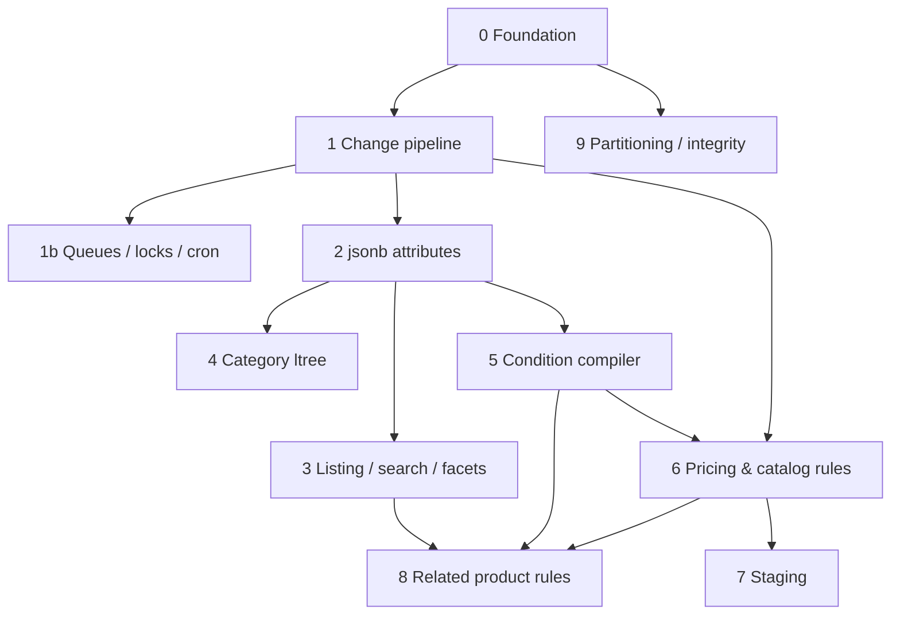

# Horobyna — Magento on PostgreSQL: Architecture Roadmap (Overview)

## Purpose

An experimental project. A PostgreSQL driver for Magento already exists (alpha; Magento installs and runs).
Driver compatibility is the **means**, not the goal. The goal is to use PostgreSQL-native features to
rethink weak or outdated parts of Magento's backend architecture:

- EAV → `jsonb` attribute storage with a safe migration path
- OpenSearch → PostgreSQL full-text search + GIN-based filtering and facets
- `mview` → a native change pipeline (statement triggers, dirty sets, `LISTEN/NOTIFY`, `SKIP LOCKED`)
- Daily-recomputed price/rule indexes → time ranges (`tstzrange`) and on-read evaluation
- PHP rule evaluation → a **condition compiler** (Magento rule conditions → `jsonpath` / SQL)
- Content staging → range types, exclusion constraints, layered patches

Non-goals:
- Production readiness or full Adobe Commerce compatibility.
- Keeping MySQL parity for new features (MySQL compatibility only for the baseline driver).
- The alternative storefront (Web Components + signals) is a separate track. Phase 3 (listing/search API)
  is the natural backend for it.

## Core principles

1. **Every phase leaves reusable infrastructure** (schema extensions, change pipeline, migration pattern,
   condition compiler, adapters). Later phases must build on it instead of re-inventing it.
2. **Magento APIs are the contract.** Repositories, collections, `SearchCriteria`, search request/response,
   indexer interfaces. Third-party modules should keep working through them.
3. **Every feature is a module behind a feature flag** and can be switched off to compare with stock behaviour.
4. **Measure before and after.** Every phase records benchmark numbers in `docs/bench/` (see 01-foundation).
5. **Standard migration pattern** (used in phases 2, 6, 7):
   shadow structure → keep in sync via pipeline → reconcile until zero diffs → switch reads → switch writes → drop legacy.
6. **Hot data apart from cold data.** Frequently changing values (stock, prices) live in narrow tables, never in wide rows.
7. **Built-in first.** If a declarative PostgreSQL feature solves the problem (constraint, exclusion constraint, generated column,
   range type, `ltree`, partitioning, FTS, advisory lock, `SKIP LOCKED`), use it. Custom infrastructure (pipeline, compiler,
   read models) only where the computation cannot be expressed declaratively — e.g. cross-entity aggregates, price folding.
8. **Keep the pipeline minimal.** Prefer synchronous, same-entity derivations (generated columns, row triggers).
   Asynchronous processing only for expensive cross-entity recomputation.
9. **Responsibility boundary.** PostgreSQL owns data invariants, time semantics, search, concurrency and indexing.
   Business rules (pricing, promotions, cart totals) stay in the application. Moving business logic into PL/pgSQL is not
   a simplification — it relocates complexity to a place that is harder to test, debug and deploy.
10. **Measure simplification like performance.** Every phase records what it removes and what it adds (see
    *Complexity scorecard*). A phase that adds more than it removes must be a conscious decision for performance or features.

## Phase types

- **Simplification** — removes Magento logic/components because PostgreSQL provides it out of the box. Highest priority for the project goal.
- **Enabler** — infrastructure other phases need (foundation, pipeline).
- **Functional** — adds capability or performance; net complexity may grow. Must not crowd out simplification phases.

## Phases

| # | Doc | Phase | Type | Depends on | Reusable output |
|---|-----|-------|------|------------|-----------------|
| 0 | 01-foundation.md | Foundation: driver hardening, test & bench harness, schema extensions, flags | Enabler | — | Bench harness, PG-aware `db_schema.xml`, feature flags |
| 1 | 02-change-pipeline.md | Change pipeline (mview replacement) | Enabler | 0 | Generic change capture + worker |
| 1b | 03-queues-locks-cron.md | Message queue, locks, cron on PG | Simplification | 0, 1 | Queue adapter, advisory locks |
| 2 | 04-jsonb-attributes.md | jsonb instead of EAV + `product_listing` read model | Simplification | 0, 1 | Migration pattern, resolved per-store read model |
| 3 | 05-listing-search-facets.md | Search engine adapter: filters, sort, pagination, facets, FTS | Simplification | 2 | Listing query builder, sort/filter providers |
| 4 | 06-category-tree-ltree.md | Category tree on `ltree`, anchor categories on read | Simplification | 0, 2 | Subtree expansion, positions model |
| 5 | 07-condition-compiler.md | Condition compiler (rule conditions → jsonpath/SQL) | Functional | 2 | Compiler used by phases 6, 8 and widgets |
| 6 | 08-pricing-catalog-rules.md | Prices with `tstzrange`, catalog rules without daily cron | Simplification | 1, 2, 5 | `product_price` ranges, rule folding |
| 7 | 09-staging.md | Staging via ranges + jsonb patches | Functional* | 2, 6 | Temporal layering, preview-by-timestamp |
| 8 | 10-related-product-rules.md | Related product rules (TargetRule-like), optional pgvector | Functional | 3, 5, 6 | Correlated conditions, on-read blocks |
| 9 | 11-partitioning-integrity-reports.md | Partitioning, BRIN, constraints, report matviews | Simplification | 0 | Independent; good "rest" tasks |
| X | 12-experimental.md | RLS, UNLOGGED cache, pg_ivm, CDC, pgvector search | Research | varies | Research notes |

\* Staging is a large simplification compared with Adobe Commerce `Magento_Staging`, but on Open Source it adds a new feature.

## Complexity scorecard

What each phase is expected to **remove** (logic PostgreSQL provides out of the box) and what it **adds** (own code to maintain).
Update the "Actual" columns in each phase's Decisions log when the phase is done.

| Phase | Removes | Adds |
|-------|---------|------|
| 0 | — | Schema extension, flags, bench harness |
| 1 | `*_cl` changelog versioning, `mview_state` polling, changelog cleanup cron, lost-update gap | Pipeline config, trigger generator, worker |
| 1b | MySQL `GET_LOCK` backend, cron double-run logic, RabbitMQ (small installs) | Queue adapter |
| 2 | 5 EAV value tables per entity, flat tables, `catalog_product_index_eav`, per-attribute joins | `product_listing` projection; temporary migration tooling (must be deleted after M5) |
| 3 | OpenSearch service, push-to-engine indexing, engine sync | Search adapter, request→SQL mapper, sort/filter providers |
| 4 | `catalog_category_product` index, PHP `level`/`children_count` maintenance, recursive tree logic | Subtree resolver |
| 5 | Per-product PHP `validate()` loop (performance only) | **New:** IR, normalizer, jsonpath/SQL backends, differential tests |
| 6 | `catalogrule_product_price` per-day tables, daily rule cron, manual timezone handling | Segment builder, rule folding |
| 7 | (vs Commerce) `row_id`, `sequence_*`, version-switch cron, rollback rows, PHP overlap checks | Campaign model, resolver with timestamp, minimal admin UI |
| 8 | (vs Commerce) `magento_targetrule_index` | Rule storage, `SourceRef` compilation, block query builder |
| 9 | Log cleanup crons and `DELETE` bloat, PHP-only integrity checks, report aggregation refresh code | Partition maintenance job, constraint catalogue |

Scorecard metrics to record per phase (next to performance numbers in `docs/bench/`):
indexers removed · cron jobs removed · tables removed/added · external services removed · PHP LOC removed/added · SQL/PL/pgSQL LOC added.

## Conventions

- **Target:** PostgreSQL 18+ (needed for `WITHOUT OVERLAPS` temporal keys; everything else works on 16/17).
- **Extensions:** core — `btree_gist`, `ltree`, `pg_trgm`, `pg_stat_statements`.
  Optional — `pg_cron`, `pg_ivm`, `pg_roaringbitmap`, `pgvector`.
- **Module namespace:** `Horobyna_*` (Horobyna — Ukrainian for rowan; vendor prefix for Composer: `horobyna/*`). One module per phase, e.g.
  `Horobyna_Schema`, `Horobyna_Pipeline`, `Horobyna_Attributes`, `Horobyna_Search`, `Horobyna_CategoryTree`,
  `Horobyna_Conditions`, `Horobyna_Pricing`, `Horobyna_Staging`, `Horobyna_TargetRule`.
- **Feature flags:** config path `horobyna/features/<feature>` (see 01-foundation, task P0.5).
- **Task IDs:** `P<phase>.<n>` (e.g. `P2.3`). Reference them in commits and branch names.
- **SQL functions/triggers:** live in `etc/pg/*.sql` inside the module, idempotent (`CREATE OR REPLACE`), applied on `setup:upgrade`.

## Standard metrics (record for every phase)

| Metric | How |
|--------|-----|
| Full reindex time (per indexer) | `bin/magento indexer:reindex <id>` timed |
| Import time, 10k / 100k products | `bin/magento import` or the import API, timed |
| Product save latency (admin/API) | p50/p95 over N saves |
| Category page query latency | p50/p95, captured via `pg_stat_statements` |
| Search query latency + facet latency | p50/p95 |
| DB size (total and per relevant table) | `pg_total_relation_size` |
| Pipeline lag / queue depth | `horobyna_pipeline_status` view (phase 1) |
| Complexity delta | Scorecard metrics (see *Complexity scorecard*) |

Fixture profiles: `setup:performance:generate-fixtures` with `small`, `medium`, `large` (plus a custom profile
with a realistic number of filterable attributes for facet tests).

## How to use these docs with Claude Code

1. Copy this folder into the repo as `docs/roadmap/`.
2. In `CLAUDE.md`, add a line: *"Architecture roadmap lives in docs/roadmap/. Before working on a task,
   read 00-overview.md and the phase doc for the task ID."*
3. Work **one phase doc per session**. Ask Claude Code to implement a specific task ID, e.g.
   *"Implement P1.3 from docs/roadmap/02-change-pipeline.md"*.
4. Tick checkboxes in the phase doc as tasks complete; append findings to the doc's **Decisions log** section.
5. Put benchmark results in `docs/bench/<phase>-<date>.md` using the template in 01-foundation.

## Phase doc template

Every phase doc has the same sections:
**Goal · Magento today · Depends on · Design · Tasks · Magento integration points · Acceptance criteria ·
Benchmarks · Risks & open questions · Decisions log.**
